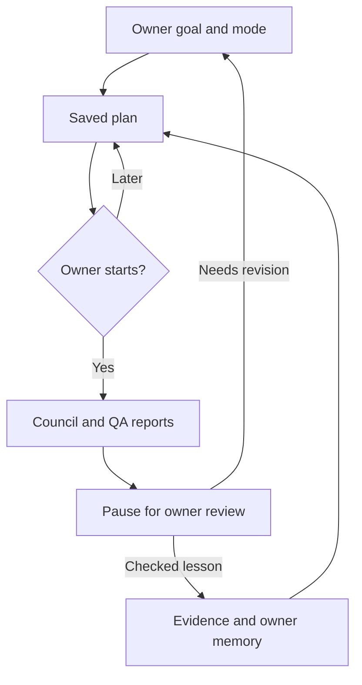

# JARVIS missions and the agentic implementation guide

The reference image is a map of alternative building blocks, not one application
or a requirement to install every listed framework. JARVIS uses a small Python
workflow engine, the existing specialist council and SQLite. The new **Missions**
tab connects a goal to a saved plan, execution record, owner review and optional
owner-written lesson. No package, hosting service or paid account is added.

## Use it from an Android phone

1. Open JARVIS, connect with the existing Swarm token, then tap **Missions**.
2. Describe one goal. Keep **Free rules planning** for deterministic prioritization
   of supplied evidence and deadlines. Select **AI specialist council** when you
   want model analysis of that goal and have provider credit.
3. Tap **Build and save plan**. Inspect fresh, stale and missing sources, selected
   memory, roles and the maximum model-call count. This step spends no model calls.
4. Tap **Start reviewed plan**. AI start rechecks the shared execution slot, daily
   call allowance and reviewed cap. A changed plan needs fresh approval.
5. Reopen the saved mission to follow its real council record. It pauses for your
   review when the council finishes. Choose **Useful** or **Needs revision**, and
   write a short note. Completion of planning is not proof the business goal was met.
6. Optionally write a lesson you have checked. Only that owner-written text becomes
   a shared procedure. Future AI councils can retrieve it for relevant agendas.

An interrupted run remains available for review. It cannot be marked successful or
silently restarted; explicitly create a new mission if another run is warranted.
Stop requests allow an in-flight call to finish, then prevent the next call. Calls
already reserved stay reserved because they may have incurred provider charges.
Approving a mission never sends messages, publishes content, places orders or
trades. Those external operations are not part of this workflow.

## How the project matches the image

| Guide component | Current implementation | Boundary / next step |
| --- | --- | --- |
| Architectures | Bounded specialist → QA → chief council; explicit goal workflows | Workflow steps are code-defined. This is not an unrestricted, model-directed agent loop. |
| Memory | Current context, saved owner records, meeting history, reviewed procedures | Keyword/priority retrieval; no vector database or automatic model retraining. |
| Human review | Plan start, persisted review pause, stop, idempotent review and lesson saving | Returning to a review checkpoint resumes the workflow; interrupted paid calls are never replayed. |
| Tools and protocols | Fixed internal operations for context, council execution and owner memory | No arbitrary tool names, shell execution, MCP or A2A transport. Hosted account access still requires its own configured connectors. |
| Retrieval | Agenda-relevant memory and timestamped source evidence, with missing/stale inputs shown | No vector RAG, web research loop or claim that an account has been read when it has not. |
| Evaluation and visibility | Recorded checkpoints, actual council calls, partial reports, owner usefulness ratings and regression tests | Ratings are owner judgments. They do not establish revenue, factual accuracy or provider dollar cost. |
| Runtime and security | Existing FastAPI process, SQLite transactions, owner bearer auth, bounded calls and internal operations | No code sandbox is needed because missions cannot execute arbitrary code. The 3D Swarm and shared glass theme stay in place. |
| Deployment roadmap | Local tests → CI → existing deployment → authenticated smoke checks | Durable storage and always-on execution remain a separate hosting decision. |

The workflow/agent distinction follows
[Anthropic's architectural guide](https://www.anthropic.com/research/building-effective-agents):
defined workflows are appropriate for bounded, inspectable tasks; dynamically
selected actions require a separate tool contract and stronger evaluation.

## API and checkpoints

All routes require the existing owner bearer token under `/api/brain/missions`:

| Method and path | Behavior |
| --- | --- |
| `GET /` | Summaries and owner-rated outcomes; no model execution |
| `POST /` | Save `{request_id, goal, mode}` with an inspectable plan; default mode `rules` |
| `GET /{id}` | Current checkpoint, result, plan and audit events |
| `POST /{id}/refresh` | Refresh an unstarted plan and replace its approval version |
| `POST /{id}/start` | Require the exact `plan_id` and integer `approved_model_calls` (0–6) |
| `POST /{id}/cancel` | Record stop; no replay or refund of reserved calls |
| `POST /{id}/review` | Atomically save `{outcome, note, lesson?}`; optional lesson becomes owner memory |

The root route has no trailing slash in the implementation. A repeated creation
request ID with the same input returns the same mission; changed input conflicts.
Starting uses a stable council request ID, a transactional claim and a cancellation
guard. Concurrent starts cannot create two councils. Repeated identical reviews
return the saved result; conflicting reviews return HTTP 409. Provider errors are
sanitized and preserve partial reports. Recovery marks unfinished work interrupted.

There are at most 60 saved missions. The limit returns an explicit error instead
of silently deleting history. Unreviewed mission reports are pinned against the
council's 120-meeting retention policy. Reviewed missions keep a compact result,
call count and context IDs even after the full council report ages out. The UI
offers full reports only while they remain available.

Checkpoint persistence requires the SQLite file to survive. It handles browser
reloads and process restarts with the same database; it does **not** make a free
Render filesystem durable. **Memory → Export private backup** now includes all
mission records. Export before deployments. This release does not add an automatic
off-host backup or full-backup restore endpoint; do not treat exported JSON as an
automatically restored workspace.

## Evaluation and rollout

`PYTHONPATH=. python -m pytest -q` and `node --test tests/jarvis-*.test.cjs` cover:
free planning, private endpoints, unsupported tool fields, changed approvals,
budget changes, duplicate and concurrent starts, cancellation races, provider
failure, restart recovery without paid replay, owner-reviewed lessons, retention,
and browser form behavior. Provider tests are stubs and do not verify live credit.

The live smoke check should save a clearly labeled rules-only verification mission,
start it once, confirm the owner-review pause, save a review without a lesson,
reopen it and verify zero model calls. Do not make a paid AI run merely to test a
deployment. Inspect the phone layout and existing 3D Swarm separately.

The next justified upgrades are durable storage and a recovery path, one useful
authenticated read tool at a time, and a representative goal/result evaluation set.
Add dynamic tool planning, vector retrieval or MCP only when a measured workflow
need makes the added cost and complexity worthwhile.
